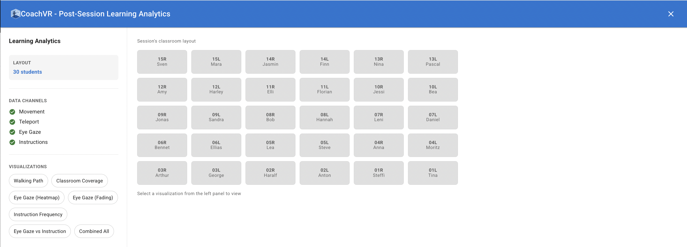

# Teach-R Post Session Analytics Visualisations Project

## Project Overview

This project focuses on the development and exploration of interactive visualizations for post-session learning analytics within the Teach-R project.

The aim was to explore different ways of representing student behaviour and classroom activity of the trainee (teacher) through interactive visualizations, making collected learning analytics data easier to inspect and interpret.

This repository is a project showcase. It does not contain the original Teach-R application, its integrated source code, or the underlying learning-session data.

## Development Process

The work initially started with a standalone React prototype developed to experiment with different visualization approaches and evaluate their suitability for the available learning analytics data.

Following this prototyping phase, the selected visualizations were further developed, modularized, and integrated into the existing Teach-R application as part of the post-session analytics interface.

**Note:** This repository presents examples of the visualizations and documents my contribution to the project.

## My Contribution

My work focused on the visualization component of the post-session analytics interface. This included:

- Explored different ways to represent student behaviour and classroom activity.

- Developed and tested interactive visualization approaches.

- Used React and Plotly to create visual representations of learning analytics data.

- Modularized selected visualization components.

- Integrated the visualizations into the existing Teach-R application.

## Data Channels: 

**Movement** (Trainee Position and Rotation info over time), 
**Eye Tracking** (Position and Duration info), 
**Instructions** (Instruction name and type with student seat positions and student names)

**Student Positions**: 
they come from the json data 'session started' statement. If the positions do not exist in the Learning Locker data then it falls back to unity message sent.

For the seat badges the mean X and Z coordinates are calcualted and used to plot in order to align the student seat rows and columns (they differ slightly: e.g. 0.732 and 0.729).

## Plots:

 

**Walking Path:** Teacher X/Z positions from movement events are used together with the rotation information. Path segments fade with time, recent segments higher density. There is a history parameter that can be changed by the user. Path color can be changed to be a single color or a color palete.

**Classroom Coverage:** Heatmap of teacher's movement, classroom space covered by walking. Shows spatial density across the room. Color scale options present.

**Eye Gaze Heatmap (+Histogram):** Heatmap for eye tracking positions, classroom space covered by looking. Shows spatial density across  the classroom. The additional histogram below classroom objects and how many times they were looked at.

**Eye Gaze Fading (Attention Cumulative and Student Fading):** Two versions: students fading and cumulative attention. Student fading mode shows how recently the trainee’s look was around each student's seat. Bubbles around the student names represent the recency of attention with changing size and opacity. The attention threshold is 60 seconds: meaning a seat fades out if not looked at in the last 60 seconds. Hover information gives the attention in percentage: 0% again meaning no attention in the last 60 seconds and 100% meaning eye gaze is close enough for at that moment in the time. Cumulative attention mode shows the cumulative amount of eye gaze each student received throughout the session as changing bubble size and opacity. Hover information gives the total seconds which that position received attention (eye gaze duration total).

**Eye Gaze vs. Instruction:** Seat badges coloured by behaviour category for instruction events within 8s before current eye gaze timestamp. A cone with its vertex at the eye gaze position shows the attention within the class. 

**Instruction Frequency :** Density, i.e. border width, border opacity and background opacity, indicates instruction counts. Hover information gives the total number if instructions received by each student and the percentage of behaviour categories. User can click on a a student and choose between bar chart / waffle chart to see the behaivour category distributions and instruction counts.

**Combined:** Movement path, eye gaze cone and student instructions combined in a single plot. Note: different from the previous eye gaze cone here the vertex is on the trainee location coming from the movement position data.

## Repository Contents

learning-analytics-demo/
│
├── README.md
│
└── media/
    ├── Walking_Path.png
    ├── Classroom_Coverage.png
    ├── EyeGaze_Heatmap.png
    ├── EyeGaze_Fading.png
    ├── Instruction_Frequency.png
    ├── Combined.png
    ├── EyeGaze_vs_Instruction.png
    └── demo_video.mp4

### Acknowledgements

This work was carried out as part of my student assistant position within the Learning Technologies Research Group RWTH Aachen for the Teach-R project.

